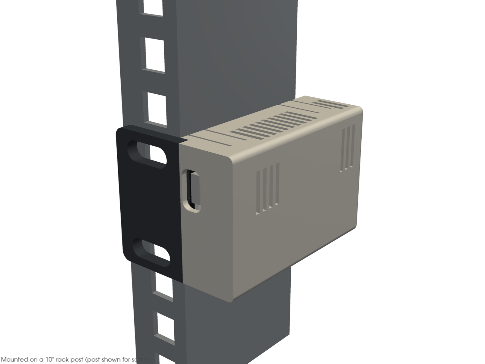
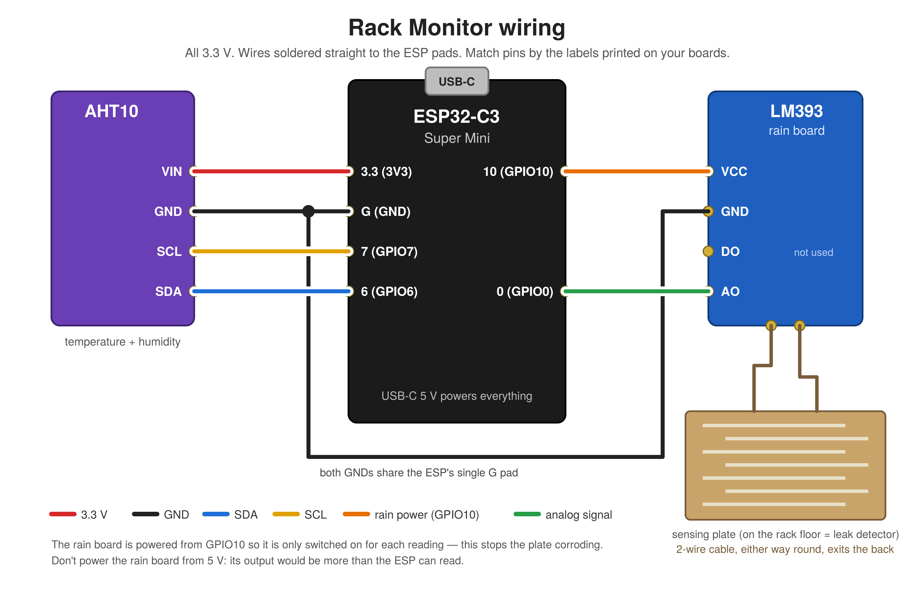

# Rack Monitor

Temperature, humidity and leak monitor for 10-inch mini racks. It bolts to a rack post and reports to Home Assistant through ESPHome.



- **Parts:** ESP32-C3 Super Mini, AHT10 module, LM393 rain-sensor kit
- **Case:** two 3D-printed parts that snap together, 44 mm tall (fits within 1U); print files on MakerWorld
- **Firmware:** [`rack-monitor.yaml`](rack-monitor.yaml), a ready-made ESPHome config with no code to write

## Wiring



| From | To ESP32-C3 |
| --- | --- |
| AHT10 VIN | 3.3 (3V3) |
| AHT10 GND | G (GND) |
| AHT10 SCL | GPIO7 |
| AHT10 SDA | GPIO6 |
| Rain board VCC | GPIO10 |
| Rain board GND | G (GND), shared with the AHT10 |
| Rain board AO | GPIO0 |

The rain board is powered from GPIO10 so it's only on during each reading, which stops the sensing plate corroding. Don't power it from 5 V: its output would go above what the ESP can measure.

## Installing the firmware

1. In Home Assistant, install the **ESPHome Device Builder** add-on and create a new device.
2. Replace its config with [`rack-monitor.yaml`](rack-monitor.yaml), keeping the encryption key ESPHome generated for you.
3. Add `wifi_ssid`, `wifi_password` and `ota_password` in ESPHome's **Secrets** (see [`secrets.yaml.example`](secrets.yaml.example)).
4. Flash it once over USB. After that, updates install over Wi-Fi.

### What Home Assistant shows

| Entity | What it is |
| --- | --- |
| Temperature, Humidity | From the AHT10, every 30 s |
| Leak | Checked every 10 s; on when the plate is wet |
| Leak threshold | Slider for how wet counts as wet (a dry plate reads about 3.2 V) |
| Leak sensor voltage | Raw reading, for setting the threshold |
| Wi-Fi signal, Uptime | Diagnostics |

## Troubleshooting

- **Wi-Fi fails with "Auth Expired":** many C3 Super Minis can't connect at full transmit power. The config sets `output_power: 8.5dB`, which fixes it. Use **Clean Build Files** in ESPHome after changing it.
- **No temperature or humidity readings:** some boards sold as AHT10 need `variant: AHT20`.
- **Weak signal inside the rack:** mount the box on the outside of a post.

## Remixing the case

The case is generated by [`cad/case.py`](cad/case.py), which uses [CadQuery](https://cadquery.readthedocs.io). Change the board sizes and fit settings at the top of the file, then run:

```bash
pip install cadquery trimesh pyvista
cd cad
python3 case.py      # checks the model, writes STEP files
python3 render.py    # writes STLs and renders to out/
```

| Setting | What it controls |
| --- | --- |
| `RAIN`, `AHT` | Board length, width and thickness |
| `cl` (in `AHT`) | How tightly the AHT10 fits; larger is looser |
| `PLUG` | `14` for DuPont plugs on the rain board; `7.5` if you solder to its pins (a shorter box) |
| `SLOT_X` | Where the screw slots sit, to suit your rack posts |

## License

MIT. See [LICENSE](LICENSE).
